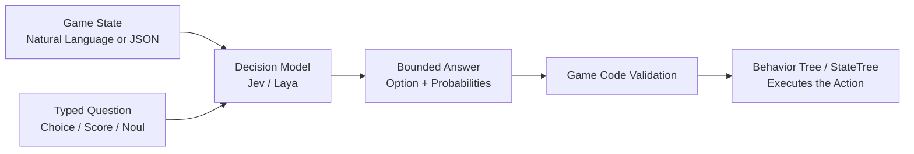
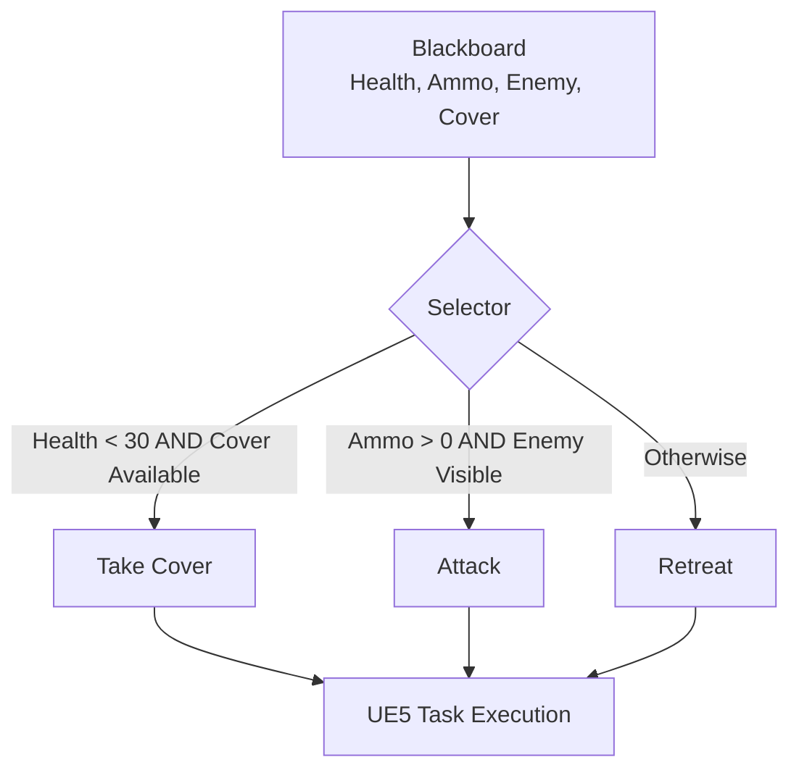
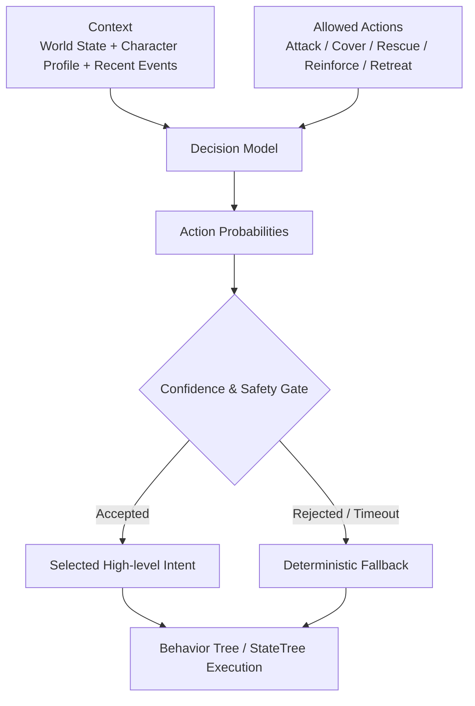
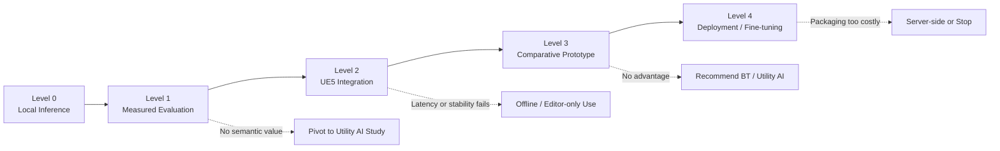

# 以提升遊戲情境決策彈性為目的之 Decision Model 導入 Unreal Engine 5 可行性研究

> 提案版本：2026-10-26  
> 預計研究期間：一個月  
> 研究對象：Jev 類型 Decision Model、開源模型 Laya、UE5 Behavior Tree／StateTree／Utility AI

---

## 0. 一頁摘要

本研究希望確認：當遊戲角色或遊戲系統需要根據多項狀態、角色設定與設計意圖做出高階選擇時，Decision Model 是否能提供比大量手寫規則更有彈性、且仍可控制輸出範圍的實作方式。

研究不以「一定採用 AI」為前提，也不打算以模型取代 Behavior Tree、StateTree、導航或戰鬥系統。Decision Model 僅負責在遊戲已允許的有限選項中提出判斷，實際行為仍由 UE5 既有系統執行。

本研究將比較：

- 明確規則／Behavior Tree。
- StateTree Utility／Utility AI。
- Laya 本地 Decision Model。

最後以決策品質、開發與維護成本、延遲、VRAM、部署方式及失敗風險，提出 Go、Conditional Go 或 No-Go 建議。

---

## 1. 研究題目

### 正式題目

> **以提升遊戲情境決策彈性為目的之 Decision Model 導入 Unreal Engine 5 可行性研究**

### 簡報短標題

> **Decision Model × Unreal Engine 5：遊戲情境決策的可行性研究**

### 題目選擇理由

本題目刻意不寫成「Laya 導入研究」或「Jev 導入研究」。本研究真正要回答的不是某個模型能不能成功串接，而是：

> Decision Model 是否適合公司目前或未來的遊戲決策需求？

Laya 是本次選用的開源驗證模型；Jev 則是用來說明 Decision Model 概念與現有應用的代表性產品。

---

## 2. 研究動機

### 2.1 最初想解決的問題

最初構想是讓 NPC 或遊戲系統能夠綜合以下資訊做出情境化決策：

- NPC 目前生命、彈藥、位置與可用資源。
- 隊友、敵人與任務目標的狀態。
- 角色性格、職責與當前優先事項。
- 最近發生的事件與行動結果。
- 遊戲設計者以文字描述的意圖。

例如，同樣是生命值偏低的角色，可能因為「膽小且重視生存」、「忠於隊友」或「必須保護醫療兵」而採取不同的高階策略。

### 2.2 為什麼開始注意 Decision Model

傳統規則可以精確處理明確條件：

```cpp
if (Health < 30 && Ammo == 0)
{
    Retreat();
}
```

但是當條件數量、角色設定與例外逐漸增加時，可能產生：

- 規則交叉與優先順序增加。
- 新增角色類型時必須重新調整大量條件。
- 設計意圖必須先被程式化為數值與門檻。
- 行為結果雖可預測，但規則維護成本可能提高。

Decision Model 的特點是能讀取文字化或結構化情境，再從程式預先提供的有限候選中選擇答案。因此產生以下研究假設：

> 在包含模糊語意、角色人格或複合情境的低頻高階決策上，Decision Model 可能降低部分規則建置與調整成本。

### 2.3 本研究目的

因此，本研究將透過相同測試情境，比較規則、Utility AI 與 Decision Model，確認：

1. Decision Model 是否能做出符合設計期待的選擇。
2. 哪些問題其實只需要 `if / else`、Behavior Tree 或 Utility AI。
3. 哪些具有模糊語意的問題可能值得使用 Decision Model。
4. 本地推論的延遲、硬體與部署成本是否適合遊戲產品。
5. 若模型不適用，能否留下可重複使用的技術選型依據。

---

## 3. Jev／Decision Model 是什麼

### 3.1 簡單定義

Jev 是 Decision Model 的代表性實作之一。它不是聊天機器人，也不是用來生成任意文章或遊戲台詞的模型。

它的工作方式是：

1. 接收一段描述目前情境的文字或 JSON。
2. 接收一個要判斷的問題。
3. 從應用程式事先限定的答案中做出選擇、評分或二元機率判斷。



### 3.2 與 ChatGPT 相似和不同之處

相似處：

- 情境與要求可以用一般自然語言描述。
- 不需要把所有語意手動轉換成固定數值公式。
- 模型可以綜合多項上下文做判斷。

不同處：

- ChatGPT 會生成自由文字；Decision Model 不生成任意答案。
- Decision Model 的回答種類必須由程式事先限定。
- API 實際傳輸時仍使用 JSON envelope，包含問題種類與候選答案。
- 模型只負責判斷；遊戲程式仍負責驗證與執行。

> 簡化說法：輸入內容可以像向 ChatGPT 描述情境，但輸出不是一段聊天回答，而是程式可直接處理的有限答案與機率。

### 3.3 Sample Input／Output

以下資料刻意使用英文，以接近實際模型輸入與簡報展示需求。

#### Human-readable input

```text
State:
The NPC is wounded and has limited ammunition.
An allied medic is incapacitated nearby.
Two enemies are advancing, but solid cover is available.
The NPC is loyal to teammates but avoids unnecessary risk.

Question:
Which high-level action best matches the situation and character?

Allowed actions:
- Attack
- TakeCover
- RescueMedic
- CallReinforcements
- Retreat
```

#### Actual API-style input

```json
{
  "state": "The NPC is wounded and has limited ammunition. An allied medic is incapacitated nearby. Two enemies are advancing, but solid cover is available. The NPC is loyal to teammates but avoids unnecessary risk.",
  "questions": {
    "next_action": {
      "type": "choice",
      "instructions": "Which high-level action best matches the situation and character?",
      "criteria": {
        "attack": "Attack the advancing enemies immediately.",
        "take_cover": "Move to cover and hold position.",
        "rescue_medic": "Attempt to rescue the allied medic.",
        "call_reinforcements": "Request support before engaging.",
        "retreat": "Withdraw from the encounter."
      }
    }
  }
}
```

#### Sample output

```json
{
  "next_action": {
    "choice": "call_reinforcements",
    "probabilities": {
      "attack": 0.04,
      "take_cover": 0.21,
      "rescue_medic": 0.24,
      "call_reinforcements": 0.43,
      "retreat": 0.08
    }
  }
}
```

這個結果不會直接讓 NPC 呼叫支援。遊戲程式仍須確認答案在白名單內、情境版本仍有效，最後才讓 Behavior Tree 或 StateTree 執行 `CallReinforcements`。

### 3.4 三種主要回答形式

| Type | Purpose | Example output |
|---|---|---|
| `choice` | 從有限候選中選一項 | `"call_reinforcements"` |
| `score` | 根據有順序的描述尺度評分 | `2.4 / 4` |
| `noul` | 回傳 Yes／No 命題為真的機率 | `0.82` |

回答種類少是優點也是限制：

- 優點：輸出可驗證、容易接進程式、不能自行發明任意指令。
- 限制：無法產生新台詞、自由計畫或不存在於候選中的動作。

---

## 4. 與 Behavior Tree、Utility AI 的差異

### 4.1 Behavior Tree 如何做決策

Behavior Tree 由開發者明確定義判斷流程。Blackboard 保存狀態，Decorator 決定分支是否可進入，Selector 依優先順序選擇第一個可行分支，Task 執行實際行為。



特性：

- 規則、優先順序與結果都由開發者明確設定。
- 執行快速、確定、容易追蹤。
- 適合即時、權威性及安全相關的遊戲邏輯。
- 條件與例外很多時，樹與 Blackboard 欄位可能逐漸複雜。

### 4.2 Decision Model 如何做決策

Decision Model 不需要開發者先把完整判斷流程畫成樹，而是提供情境、判斷準則與有限候選，讓模型回傳機率分布。



特性：

- 適合模糊語意、文字設定及難以列完的狀態組合。
- 可在固定候選內提供不同傾向。
- 會增加推論延遲、模型資源與測試成本。
- 可能判斷錯誤，不能取代遊戲安全規則與 fallback。

### 4.3 核心比較

| 比較面向 | Behavior Tree | Decision Model |
|---|---|---|
| 決策來源 | 開發者定義流程與優先順序 | 模型根據情境判斷候選 |
| 輸入 | Blackboard、Decorator 條件 | 文字或 JSON 情境＋typed question |
| 輸出 | 執行成功、失敗或下一個 Task | Choice、Score 或 Noul probability |
| 可預測性 | 高 | 較低，需測試與限制 |
| 執行成本 | 低 | 需要模型推論、記憶體與延遲 |
| 適合問題 | 明確條件、流程與即時控制 | 模糊語意、角色設定、高階低頻選擇 |
| 除錯方式 | 檢查 Tree、Blackboard、Decorator | 保存輸入、模型版本、機率與 fallback |
| 是否執行動作 | 是 | 否，只提供判斷 |

### 4.4 不是二選一

本研究預期的合理架構不是以模型取代 Behavior Tree：

```text
Decision Model = Selects high-level intent
Behavior Tree / StateTree = Executes deterministic gameplay behavior
```

例如 Decision Model 選擇 `RescueMedic`，Behavior Tree 仍負責：

- 確認醫療兵仍可救援。
- 尋找路徑。
- 選擇掩體。
- 移動、播放動畫與處理中斷。
- 失敗後切換其他行為。

### 4.5 Utility AI 是本研究必須補充的比較對象

Utility AI 會替每個候選行動計算效用分數，再選擇最高分或依權重抽選。

```text
Attack Utility  = Health × Ammo × TargetValue
Retreat Utility = Danger × LowHealth × EscapeAvailability
Rescue Utility  = Loyalty × AllyImportance × RescueFeasibility
```

它同樣能處理多因素權衡，而且比模型更容易控制與除錯。因此，本研究不能只比較 Behavior Tree 與 Decision Model，也必須研究：

- UE5 StateTree Utility 的實作方式。
- Consideration 與 Response Curve 如何表達決策。
- 相同案例使用 Utility AI 時的建置與調整成本。
- Decision Model 是否真的在模糊文字語意或維護成本上提供額外價值。

> 若 Utility AI 能以更低成本達到相同效果，研究結論應優先建議 Utility AI，而不是為了使用模型而導入模型。

---

## 5. 需要確認的事項

### 5.1 預計建立的環境

#### 已建立的研究環境

- Windows 本機環境。
- Python 3.12 獨立 `.venv`。
- PyTorch CUDA Runtime。
- Laya multilingual 開源權重。
- NVIDIA RTX 5060 Ti 16 GB 測試機。
- Python 單次推論與輸入／輸出測試腳本。

#### 預計新增

- Laya 常駐本地推論 Server。
- `/v1/systemone` 或專案自訂 HTTP API。
- UE5 非同步 HTTP Client。
- StateTree 或 Behavior Tree 的結果接收介面。
- 決策輸入、輸出、版本與 latency log。
- Server timeout、斷線與低可信結果 fallback。

### 5.2 延遲

需分別測量：

- 冷啟動載入時間。
- 模型常駐後單筆推論的 P50、P95、P99。
- 連續請求與批次問題的吞吐量。
- UE5 → Server → UE5 的完整往返時間。
- 1、5、10、20 個 NPC 同時提出請求時的排隊情形。

Decision Model 不預計每幀呼叫。初期定位為事件驅動、低頻、高階決策，例如：

- 進入新戰鬥階段。
- 任務狀態改變。
- NPC 原定策略失敗。
- 一段固定冷卻時間結束。

### 5.3 硬體與記憶體

目前本機實測 Laya multilingual：

- 模型檔案約 650 MB。
- PyTorch CUDA 載入後約使用 1.25 GB VRAM。
- 短推論後 reserved VRAM 約 1.5 GB。
- 產品規劃初期宜保守預留約 1.5～2 GB VRAM。

仍需確認：

- GGUF／量化後的大小與決策品質差異。
- CPU-only 是否可接受。
- 與 UE5 場景渲染同時執行時的 Frame Time 與 VRAM 競爭。
- 最低規格 GPU 是否可用。
- Runtime、模型與依賴加入安裝包後的容量。

### 5.4 部署與授權

- 研究階段以 Python／PyTorch 快速驗證。
- 產品化階段比較 llama.cpp、Ollama 或其他 System One 相容 Runtime。
- 確認 Runtime 與權重能否隨遊戲散布。
- 保存 License、NOTICE、模型版本與 SHA-256。
- 本地服務只監聽 localhost，不將可重複使用的雲端 API Key 放入遊戲。

### 5.5 決策品質

需建立固定測試集，測量：

- 與設計者期待的一致率。
- 可接受行動率與危險錯誤率。
- 高 confidence 但錯誤的比例。
- 同義改寫與文字順序改變後的穩定性。
- 中英文描述差異。
- 無關資訊、矛盾資訊及資訊不足時的反應。

---

## 6. 驗證／交付等級



### Level 0：本地推論成立

**目的**

確認 Laya 可在測試硬體與隔離環境內正常執行。

**交付**

- 可重建的 `.venv`。
- Laya 測試程式。
- Choice、Score、Noul 範例。
- 初步 VRAM、載入時間與 License 紀錄。

**成功條件**

- 相同輸入可重複取得合法格式輸出。
- 模型與依賴不污染系統 Python。
- 沒有立即阻止研究的硬體或授權問題。

**失敗後動作**

- 確認 CUDA、PyTorch 與模型版本。
- 改用 CPU 或 GGUF Runtime 做最小驗證。
- 若目標硬體無法載入，停止 Runtime 路線，改做 Editor／Server-side 可行性評估。

**目前狀態：已大致完成。**

### Level 1：離線決策品質可量化

**目的**

確認模型不只是能回傳答案，而是對具有模糊語意的案例具有可測量價值。

**交付**

- 100～300 筆固定情境測試集。
- 設計者標記的首選、可接受與危險選項。
- Base Laya 測試結果。
- 錯誤案例與 confidence 分析。

**成功條件**

- 結果明顯優於隨機及多數類別 baseline。
- 能指出適合與不適合模型的決策類型。
- 低信心或不合法結果能交由 fallback。

**失敗後動作**

- 先檢查 state、criteria 與問題設計是否合理。
- 將同一資料改用 Utility AI／規則 baseline。
- 若問題本質可被簡單公式解決，轉為 Utility AI 比較研究。
- 若模型在模糊案例仍沒有價值，提出 Runtime No-Go，不繼續引擎整合。

### Level 2：UE5 技術串接成立

**目的**

確認 UE5 能非同步取得 Decision Model 結果，並安全交給既有 AI 系統。

**交付**

- 本地常駐推論 Server。
- UE5 非同步 Request／Response。
- StateTree 或 Behavior Tree 接收結果。
- Debug UI 顯示輸入摘要、輸出、機率與 latency。
- Timeout、Server unavailable 與 stale result fallback。

**成功條件**

- 不阻塞 Game Thread。
- 模型只能回傳白名單行為。
- Server 中斷不會造成遊戲崩潰。
- 舊世界狀態的延遲答案不會被執行。

**失敗後動作**

- 簡化 API 與狀態大小，降低呼叫頻率。
- 將推論移到獨立 Process 或其他設備。
- 若 Runtime 延遲不適合遊戲，轉為載入關卡前、回合間或 Editor-only 使用。

### Level 3：與既有方法公平比較

**目的**

確認 Decision Model 是否比規則與 Utility AI 提供足以支付成本的實際價值。

**交付**

- 同一 UE5 情境的三種版本：
  - Rule／Behavior Tree。
  - StateTree Utility／Utility AI。
  - Laya Decision Model。
- 相同輸入、相同候選行動及相同底層執行 Task。
- 決策品質、延遲與開發／調整成本比較。

**成功條件**

- Decision Model 在至少一類模糊語意案例上展現可重複的優勢。
- 優勢不是來自不公平地給模型更多資訊。
- 設計師增加角色人格或新準則時，調整成本確實較低或結果更好。

**失敗後動作**

- 若 Behavior Tree 足夠，建議維持規則系統。
- 若 Utility AI 達成相同效果，建議改採 Utility AI。
- 保留 UE5 推論橋接、測試資料與評估工具，停止產品化 Decision Model。

### Level 4：產品化部署或 Fine-tuning 初探

**目的**

只有在 Level 3 證明值得繼續後，才評估隨遊戲部署與專案化訓練。

**交付**

- 非 Python Runtime 或可交付 Server 方案。
- 乾淨機器啟動與封裝測試。
- 安裝容量、VRAM、CPU/GPU 相容性資料。
- License／NOTICE 草案。
- Fine-tune 或 head-only training 的資料格式與小型實驗。

**成功條件**

- Runtime 與權重能以公司可接受方式散布。
- 最低規格硬體可用，或能明確限制支援範圍。
- Fine-tune 在 held-out 測試集有實質改善，而非記住訓練資料。

**失敗後動作**

- 若本地打包成本過高，評估公司控制的 Server-side 推論。
- 若 Fine-tune 無明顯改善，保留 Base Model 或停止訓練投資。
- 若整體成本大於價值，提出正式 No-Go 結論。

---

## 7. 一個月的使用方式

一個月不是只用來驗證「模型能不能跑」。Level 0 約數日即可完成，其餘時間用來建立公司可重複使用的選型證據。

### Week 1：研究問題與 baseline

- 補足 Behavior Tree、StateTree Utility 與 Decision Model 的技術比較。
- 選擇不容易被單一 `if / else` 解決的高階決策案例。
- 定義共同輸入、候選行動與正確／可接受結果。
- 建立規則與 Utility AI baseline。

### Week 2：資料集與離線評估

- 建立 100～300 筆情境。
- 批次測試 Laya。
- 分析錯誤、confidence、改寫穩定性與 latency。
- 進行第一次 Go／No-Go 判定。

### Week 3：UE5 原型與比較

- 完成非同步本地推論。
- 讓三種決策 Provider 共用相同行為執行層。
- 建立 Debug 畫面與可重播情境。
- 測量 UE5 Frame Time、VRAM 與錯誤恢復。

### Week 4：部署、結論與提案資產

- 評估本地 Runtime 與封裝。
- 視 Level 3 結果決定是否進行 Fine-tune 小型實驗。
- 整理 Demo、數據、架構、風險與推薦方案。
- 提出 Go、Conditional Go 或 No-Go。

---

## 8. 研究成功與失敗的定義

### Go

- 找到 Decision Model 明顯優於簡單規則的使用案例。
- 決策品質與錯誤率可接受。
- 延遲、VRAM 與部署成本符合目標平台。
- 有可靠的白名單、timeout、stale-result validation 與 fallback。

### Conditional Go

- 只在特定高階、低頻、非關鍵決策中有價值。
- 只支援部分硬體或只適用 Editor／Server-side。
- 需要更多資料或有限的 Fine-tuning 才可能導入。

### No-Go

- 問題可由規則或 Utility AI 以更低成本完成。
- 模型對模糊情境仍不穩定，或高信心錯誤不可接受。
- Runtime 與渲染競爭 VRAM，或延遲影響體驗。
- 打包、平台支援與維護成本大於預期價值。

No-Go 仍是有效交付，因為它能：

- 避免公司在不適合的 AI 技術上持續投資。
- 建立 Behavior Tree、Utility AI 與 Decision Model 的選型標準。
- 留下 UE5 本地模型串接、測試資料與效能測量資產。

---

## 9. 預計最終交付

1. Decision Model／Behavior Tree／Utility AI 的入門說明。
2. Laya 本地推論環境與固定版本紀錄。
3. 可重播的情境資料集與標註規範。
4. 規則、Utility AI、Laya 三種 baseline。
5. UE5 非同步推論與 fallback 原型。
6. 延遲、VRAM、Frame Time 與安裝容量報告。
7. 決策一致率、可接受率與危險錯誤率報告。
8. License、Runtime 與權重散布評估。
9. Demo／錄影及操作說明。
10. Go、Conditional Go 或 No-Go 建議。

---

## 10. 簡報結尾建議

> 這項研究不是為了證明所有遊戲 AI 都應使用模型，也不是要以模型取代 Unreal Engine 既有 AI 系統。研究目的，是確認 Decision Model 在模糊語意、高階情境與角色設定上是否存在實際價值，並以規則與 Utility AI 作為公平比較。若最終證明既有方法更適合，該結論同樣能成為公司未來技術選型與投資判斷的依據。

