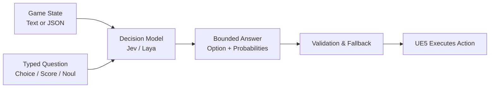
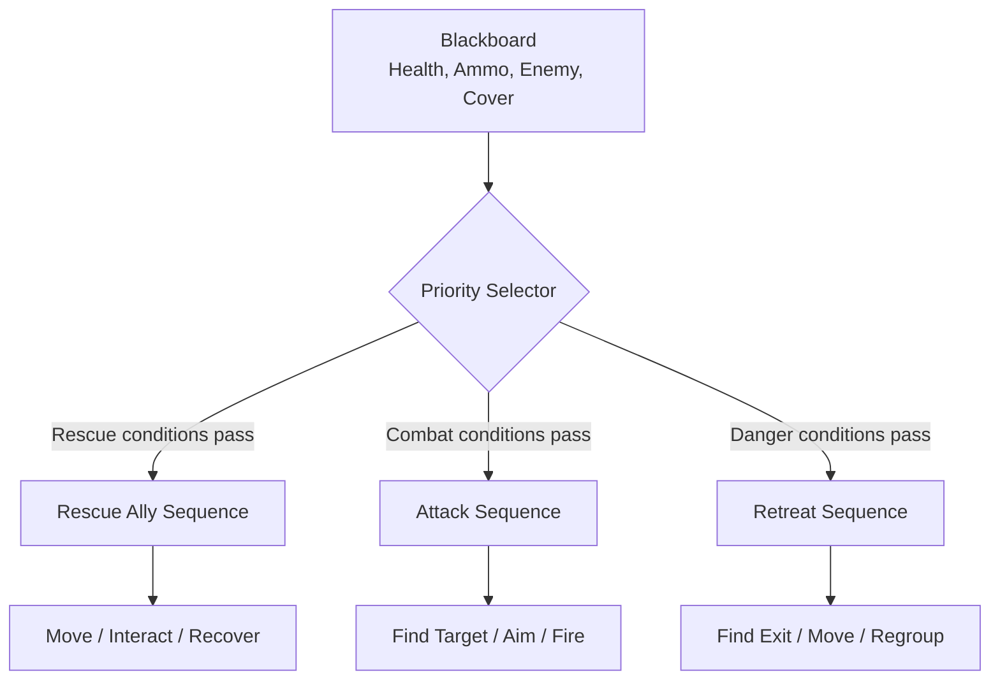
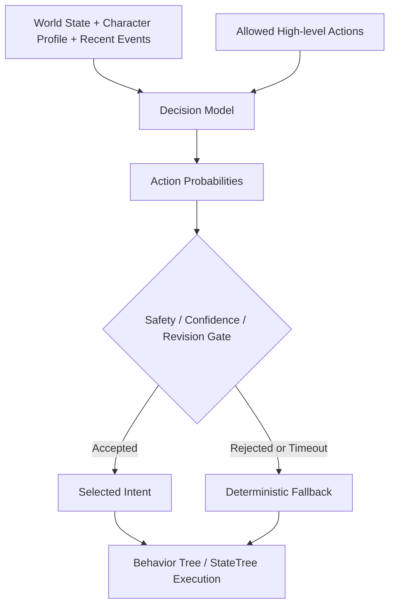
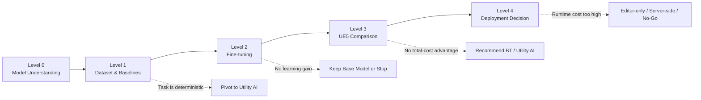

# Decision Model 能否取代 Behavior Tree？

## 以 UE5 遊戲高階行為選擇為例之模型訓練與應用研究

> 提案日期：2026-10-26  
> 研究期間：一個月  
> 課題性質：深度學習研習自由課題

---

## 1. 研究摘要

本研究起源於一個直接的構想：

> 如果 AI 模型能直接理解遊戲情境並選擇適當行為，是否可以簡化，甚至取代 Unreal Engine 5 Behavior Tree 中的決策結構？

Behavior Tree 是成熟且可靠的遊戲 AI 技術，但需要開發者預先定義條件、優先順序與行為分支。當角色人格、任務目標、事件歷史與例外情境增加時，決策規則可能逐漸複雜。

Jev 所代表的 Decision Model 則採用不同方式：模型接收自然語言或 JSON 描述的情境，再從程式預先限定的候選答案中輸出選擇、評分或二元機率。開源模型 Laya 讓本研究可以在本機進行推論、資料建立與 Fine-tuning 實驗。

然而，Decision Model 與 Behavior Tree 並非完全相同的技術。Behavior Tree 不只選擇行為，也管理執行順序、中斷、失敗恢復及遊戲系統協作。因此，本研究不預設 Decision Model 一定能完全取代 Behavior Tree，而是驗證：

1. Decision Model 可以取代 Behavior Tree 的哪些決策責任？
2. 哪些功能仍必須由 Behavior Tree、StateTree 或確定性程式負責？
3. 經遊戲領域資料微調後，模型是否能學習角色人格與專案特有的決策偏好？
4. 相較 Behavior Tree 與 Utility AI，模型是否真的降低建置或需求變更成本？
5. 模型帶來的品質是否足以抵銷延遲、VRAM、部署與除錯成本？

最終成果不以「成功導入模型」為唯一成功標準。若實驗證明現有方法更適合，也將產出一套可重複使用的技術選型依據。

---

## 2. 研究動機

### 2.1 最初構想

在遊戲 AI 中，NPC 經常需要根據生命值、彈藥、敵人、隊友與任務目標選擇下一步行動。簡單情況可用明確條件完成：

```cpp
if (Health < 30 && Ammo == 0)
{
    Retreat();
}
```

但實際角色設計可能包含更複雜的要求：

```text
This NPC is loyal but risk-averse.
The NPC normally avoids unnecessary danger,
but will take limited risks to protect an allied medic.
If the mission objective is about to be lost,
calling reinforcements takes priority over rescue.
```

若完全使用 Behavior Tree 表達，開發者需要把上述設計意圖轉換為：

- Blackboard Keys。
- Decorators 與門檻。
- Selector 優先順序。
- Service 更新條件。
- 例外分支與中斷規則。

因此最初產生以下想法：

> 是否能讓模型直接讀取角色設定與世界情境，取代 Behavior Tree 中逐步擴張的行為選擇分支？

### 2.2 從「取代目標」轉為「研究假設」

進一步調查後可知，Decision Model 只會提供判斷結果，不會自動完成導航、動畫、攻擊流程、中斷或錯誤恢復。因此「完全取代 Behavior Tree」不應是預設結論，而應成為可被驗證或否定的研究假設。

本研究的主要假設為：

> 對包含角色人格、任務優先級與複合語意狀態的高階行為選擇，經遊戲領域資料微調的 Decision Model，可能取代 Behavior Tree 中部分高階 Selector 與優先順序判斷，並降低新增角色或修改設計需求時的規則維護成本。

反方假設為：

> 若 Decision Model 的決策品質、穩定性、延遲或總維護成本未優於 Behavior Tree／Utility AI，則不應用來取代既有遊戲 AI。

### 2.3 研究目的

本研究不是單純展示模型能回傳答案，而是要找出以下邊界：

```text
What can be replaced?
What should remain deterministic?
Does fine-tuning create measurable value?
Is the total system cheaper to maintain?
```

---

## 3. Jev 與 Decision Model 簡介

### 3.1 Decision Model 是什麼

Jev 是 Decision Model 的代表性產品。它不是聊天機器人，也不是用來生成任意文章、對話或程式碼的模型。

Decision Model 接收：

1. 描述目前情境的自然語言或 JSON。
2. 應用程式要判斷的問題。
3. 問題類型與允許的答案範圍。

然後回傳程式可以直接處理的有限答案與機率。



### 3.2 與 ChatGPT 相似之處

輸入內容可以像向 ChatGPT 說明問題一樣，用一般文字描述情境與要求：

```text
The NPC is wounded and has limited ammunition.
An allied medic is incapacitated nearby.
Two enemies are advancing, but solid cover is available.
The NPC is loyal to teammates but avoids unnecessary risk.
```

模型可以理解文字中的情境、角色特質與關係，不需要先把每一句話完全轉換為固定公式。

### 3.3 與 ChatGPT 不同之處

Decision Model 不會自由回答：

```text
I think the NPC should carefully approach the medic...
```

程式必須事先限定候選答案，例如：

```text
Attack
TakeCover
RescueMedic
CallReinforcements
Retreat
```

因此更精確的描述是：

> 輸入情境可以像 ChatGPT 一樣使用自然語言；輸出則只會是應用程式事先定義的有限種類，而不是自由文字。

API 傳輸時仍使用 JSON，並明確指定問題類型與候選答案。

### 3.4 Sample Input

```json
{
  "state": "The NPC is wounded and has limited ammunition. An allied medic is incapacitated nearby. Two enemies are advancing, but solid cover is available. The NPC is loyal to teammates but avoids unnecessary risk.",
  "questions": {
    "next_action": {
      "type": "choice",
      "instructions": "Which high-level action best matches the situation and character?",
      "criteria": {
        "attack": "Attack the enemies immediately.",
        "take_cover": "Move to cover and hold position.",
        "rescue_medic": "Attempt to rescue the allied medic.",
        "call_reinforcements": "Request support before engaging.",
        "retreat": "Withdraw from the encounter."
      }
    }
  }
}
```

### 3.5 Sample Output

```json
{
  "next_action": {
    "choice": "call_reinforcements",
    "probabilities": {
      "attack": 0.04,
      "take_cover": 0.21,
      "rescue_medic": 0.24,
      "call_reinforcements": 0.43,
      "retreat": 0.08
    }
  }
}
```

模型只選擇 `call_reinforcements`。遊戲程式仍須驗證答案是否合法、狀態是否過期，再由 Behavior Tree 或 StateTree 執行實際行為。

### 3.6 回答種類

| Type | Function | Example |
|---|---|---|
| `choice` | 從有限候選中選擇一項 | `"rescue_medic"` |
| `score` | 依照有順序的尺度進行評分 | `2.4 / 4` |
| `noul` | 回傳某個 Yes／No 命題為真的機率 | `0.82` |

固定輸出範圍是 Decision Model 相較生成式 LLM 的主要特徵。它提高程式整合與驗證的可行性，但也代表模型無法自行發明候選以外的行為。

---

## 4. Behavior Tree 與 Decision Model 的責任差異

### 4.1 Behavior Tree



Behavior Tree 通常同時負責：

- Action selection。
- Priority management。
- Execution sequence。
- Blackboard state coordination。
- Interrupt handling。
- Failure recovery。
- 與 Navigation、EQS、Animation 及 Gameplay Task 協作。

### 4.2 Decision Model



Decision Model 比較接近：

- Action selection。
- 模糊優先順序判斷。
- 角色人格與情境語意的綜合判斷。

它不適合直接負責：

- 每幀移動與瞄準。
- 導航與碰撞。
- 動畫時序。
- 權威性遊戲規則。
- 精確數值運算。
- 必須保證正確的失敗恢復。

### 4.3 「取代」的程度定義

| Level | Replacement scope | Description |
|---|---|---|
| R0 | No replacement | Behavior Tree 負責決策與執行 |
| R1 | Advisory | 模型提供建議，現有邏輯決定是否採用 |
| R2 | High-level selection | 模型取代高階 Selector，Behavior Tree 執行行為 |
| R3 | Primary decision loop | 模型反覆選擇下一步，程式負責驗證與執行 |
| R4 | Full replacement | 模型同時負責決策、流程、中斷與恢復 |

本研究的合理目標為驗證 R1 與 R2；R3 作為實驗性上限。R4 不作為一個月內的預期成果。

### 4.4 核心比較

| 面向 | Behavior Tree | Decision Model |
|---|---|---|
| 判斷來源 | 開發者定義條件與流程 | 模型根據情境判斷候選 |
| 可預測性 | 高 | 需以資料集驗證 |
| 執行成本 | 低 | 需要模型、記憶體與推論時間 |
| 適合內容 | 明確條件、即時流程 | 模糊語意、高階低頻選擇 |
| 需求變更 | 修改節點、條件與權重 | 修改情境描述、候選或訓練資料 |
| 除錯 | Tree、Blackboard、Decorator | 輸入、機率、模型版本、資料集 |
| 實際執行動作 | 是 | 否 |

---

## 5. Utility AI：不可省略的比較對象

研究初期主要注意到 Behavior Tree 與 Decision Model，但進一步調查後，Utility AI 也是處理多因素行為選擇的重要方法。

Utility AI 會為每個候選行動計算效用：

```text
Attack Utility  = Health × Ammo × TargetValue
Retreat Utility = Danger × LowHealth × EscapeAvailability
Rescue Utility  = Loyalty × AllyImportance × RescueFeasibility
```

UE5 StateTree 已具備 Utility-based selection 的能力。它能處理多因素權衡，且比深度學習模型更容易控制與除錯。

因此本研究必須回答：

> Decision Model 的價值是否真的來自深度學習，還是同一問題使用 Utility AI 就能以更低成本完成？

若 Utility AI 達到相同品質，研究應如實建議 Utility AI，而不是為了使用模型而使用模型。

---

## 6. 深度學習研究內容

本課題屬於深度學習研習，因此不能只停留在呼叫現成模型與串接 UE5 API。本研究的深度學習實作將集中於 **Laya Fine-tuning、訓練結果判讀與泛化驗證**，而不是將 Tokenization、Softmax、Backpropagation 等基礎名詞各自列為獨立研究項目。

相關原理會在執行訓練時補充理解，但提案的主要工作與交付聚焦在以下可執行、可記錄的實驗。

### 6.1 建立遊戲決策訓練資料

建立包含遊戲狀態、角色人格、候選行動與期望答案的資料。每筆資料包含：

```json
{
  "state": "The NPC is wounded...",
  "question": "Which action best matches the situation?",
  "candidates": [
    "attack",
    "take_cover",
    "rescue_medic",
    "call_reinforcements",
    "retreat"
  ],
  "gold": "call_reinforcements"
}
```

實際工作包括：

- 定義角色人格、任務目標與戰鬥狀態的變化範圍。
- 為每個情境標記 preferred、acceptable、unsafe 與 wrong action。
- 檢查各候選行動的資料量，避免單一類別占比過高。
- 保留不同句型、同義改寫與未見狀態組合作為泛化測試。
- 記錄資料來源、建立規則與標註判斷依據。

資料將在訓練前固定分為：

- Training set：用來更新模型參數。
- Validation set：選擇 checkpoint 與觀察 overfitting。
- Test set：不參與訓練與參數選擇，只在最後比較使用。

**預計記錄：**

- 各資料集筆數與類別比例。
- 各角色人格與狀態組合的覆蓋情況。
- 標註無法形成共識或沒有唯一答案的案例。

### 6.2 建立 Fine-tuning 前的 Base Laya Baseline

使用尚未針對本研究資料訓練的 Laya 執行固定評估集，保存每筆輸入的預測答案與機率。

**實際工作：**

- 固定模型、Runtime、問題 schema 與候選描述版本。
- 批次執行 Base Laya。
- 保存 expected answer、predicted answer 與各選項 probability。
- 計算 preferred、acceptable、unsafe action rate 與 Macro F1。

**目的：**

建立 Fine-tuning 前的比較基準，避免最後只能說模型「看起來有進步」，卻沒有可比較數據。

### 6.3 執行 Head-only Fine-tuning

本月主要訓練實驗為 Head-only Fine-tuning：凍結主要 Encoder，只更新 Decision Head，觀察模型能否以較低訓練成本學會遊戲領域的角色決策偏好。

```text
Encoder:       Frozen
Decision Head: Trainable
```

**實際工作：**

- 將資料轉換成 Laya 官方訓練工具所需格式。
- 固定隨機種子並保存完整訓練設定。
- 執行 Head-only Fine-tuning。
- 每個 epoch 評估 validation set。
- 保存最佳 checkpoint，而不是只保留最後一次訓練結果。

**預計記錄：**

- Training loss 與 validation loss。
- Validation accuracy／Macro F1。
- 每個 epoch 所需時間。
- 總訓練時間與峰值 VRAM。
- Trainable parameter count。
- Checkpoint size。

### 6.4 有限度比較訓練設定

本研究不以大量超參數搜尋為目標，而是針對會直接影響 Fine-tuning 的主要設定進行小規模比較。

預計比較：

- 2～3 組 learning rate。
- 依 VRAM 可容納範圍比較 1～2 組 batch size。
- 透過 validation loss 決定合理 epoch 數及是否 early stopping。

每次實驗必須保存：

```text
Dataset version
Model version
Random seed
Learning rate
Batch size
Epochs
Best checkpoint
Training time
Peak VRAM
Validation metrics
```

此階段要回答的不是「哪個數字理論上最好」，而是：

> 在目前硬體與資料量下，哪組設定能穩定訓練，並在 validation set 得到較好的結果？

### 6.5 判斷模型是否正常學習或 Overfitting

訓練期間將比較 training loss 與 validation loss，例如：

| Epoch | Training loss | Validation loss | Validation accuracy |
|---:|---:|---:|---:|
| 1 | 1.42 | 1.31 | 48% |
| 2 | 1.10 | 1.06 | 61% |
| 3 | 0.82 | 0.94 | 68% |
| 4 | 0.55 | 1.02 | 66% |

若 training loss 持續下降，但 validation loss 開始上升或 validation accuracy 下降，將視為可能 overfitting，並優先選用較早的 checkpoint。

**此階段的具體判斷：**

- 模型是否真的從訓練資料學到可用模式。
- 從哪個 epoch 開始出現 overfitting。
- 增加 epoch 是否改善或傷害未參與訓練的資料。
- 是否需要增加資料、重新平衡類別或降低模型更新範圍。

### 6.6 使用獨立 Test Set 驗證泛化能力

完成訓練設定與 checkpoint 選擇後，才使用 Test set 比較 Base Laya 與 Fine-tuned Laya。Test set 不用於反覆調整 learning rate、batch size 或 epoch。

除了整體指標，也要測試模型能否處理：

- Training set 未出現的狀態組合。
- 相同意義但不同文字表達的情境。
- 未參與訓練的新角色人格。
- 資訊不足、互相矛盾與邊界案例。

**最終比較指標：**

- Preferred choice rate。
- Acceptable choice rate。
- Unsafe action rate。
- Accuracy 與 Macro F1。
- Confusion matrix。
- 同義改寫後的一致性。
- 推論延遲與 Runtime VRAM。

最終報告須同時呈現改善與退步的類別，不能只列出整體平均分數。

### 6.7 Fine-tuning 結果不足時的後續處理

若 Head-only Fine-tuning 沒有在 held-out test 帶來改善，依序檢查：

1. 資料格式與標註是否正確。
2. 類別是否嚴重不平衡。
3. Training 與 test 是否過於相似或差異過大。
4. Learning rate 是否造成沒有學習或訓練不穩定。
5. 模型是否只記住固定句型。

確認上述問題後，才視時間與硬體狀況選擇：

- 增加或重新平衡資料。
- 調整候選描述與問題 schema。
- 執行 Full Fine-tuning。
- 將 LoRA 列為延伸研究。
- 停止訓練，將「模型無法在目前資料與成本下有效適應」列為研究結論。

### 6.8 本月訓練範圍

| Experiment | Trainable parameters | Purpose |
|---|---|---|
| Base Laya | None | Zero-shot baseline |
| Head-only | Decision head | 低成本領域適應 |
| Full fine-tuning | Entire model | 效果與資源上限 |
| LoRA | Low-rank adapters | 延伸研究：參數效率 |

本月必要實驗為 Base Laya 與 Head-only Fine-tuning。Full Fine-tuning 視時間與硬體結果執行；LoRA 作為延伸，不預先承諾完成。

### 6.9 深度學習實驗要回答的問題

1. Base Laya 是否已具備足夠的遊戲決策能力？
2. Head-only Fine-tuning 是否能學到角色人格與專案偏好？
3. 增加訓練資料是否持續改善未見案例？
4. 模型是否只是記住句型，而沒有真正泛化？
5. 訓練帶來的改善是否足以超越 Behavior Tree／Utility AI baseline？

---

## 7. 實驗設計

### 7.1 共用行為空間

三種方案只能選擇相同的高階行動：

```text
Attack
TakeCover
RescueAlly
CallReinforcements
Retreat
```

底層移動、導航、動畫與互動 Task 完全共用，避免把執行品質誤認為決策品質。

### 7.2 三種 Decision Provider

```text
Shared World State
├── Behavior Tree Provider
├── Utility AI Provider
└── Laya Decision Model Provider
             ↓
    Shared Gameplay Actions
```

### 7.3 決策品質驗證

設計者對每個測試情境事先標記：

```text
Preferred:  CallReinforcements
Acceptable: TakeCover, RescueAlly
Unsafe:     Attack
Wrong:      Retreat
```

測量：

- Preferred choice rate。
- Acceptable choice rate。
- Unsafe action rate。
- High-confidence error rate。
- 同義改寫後的一致性。
- 未見情境的泛化能力。

### 7.4 Behavior Tree 取代程度驗證

記錄 Behavior Tree 版本的：

- Node 數量。
- Decorator 數量。
- Blackboard Key 數量。
- Service 數量。
- Tree depth。
- 建立與修改時間。
- 需求變更後的 regression 數量。

記錄 Decision Model 版本的：

- State fields 與 criteria 數量。
- Dataset 大小與標註時間。
- 訓練與評估時間。
- Runtime 與整合程式碼。
- Fallback 與驗證規則。
- 模型改版後的 regression 數量。

不能只比較畫面上的節點數。模型可能只是把複雜度從 Tree 轉移到 Dataset、Runtime、Model Versioning 與測試流程，因此必須比較總成本。

### 7.5 需求變更實驗

基礎版本先只包含 `Aggressive` 與 `Defensive` 角色。完成後加入新需求：

```text
Add a loyal but risk-averse character.
The character avoids unnecessary danger,
prioritizes an allied medic in immediate danger,
but calls reinforcements when the mission objective may be lost.
```

分別測量三種方案：

- 修改所需時間。
- 新增的規則、Consideration 或訓練資料量。
- 是否破壞既有角色行為。
- 非程式設計者是否能理解與調整。
- 修改後 held-out test 的表現。

此實驗是「是否降低維護成本」最重要的證據。

---

## 8. 環境、延遲與硬體確認

### 8.1 已建立環境

- Windows。
- Python 3.12 獨立 `.venv`。
- PyTorch CUDA Runtime。
- Laya multilingual checkpoint。
- NVIDIA RTX 5060 Ti 16 GB。
- Python 推論測試程式。

### 8.2 預計建立

- Fine-tuning dataset 與 training／validation／test split。
- Head-only training pipeline。
- Loss、metric 與 checkpoint 紀錄。
- Laya 常駐本地推論 Server。
- `/v1/systemone` 或等效 HTTP API。
- UE5 非同步 Client。
- State revision、timeout 與 deterministic fallback。
- 遊戲內 Debug UI 與可重播測試情境。

### 8.3 延遲

測量：

- Model cold start。
- Warm inference P50／P95／P99。
- UE5 往返 latency。
- 1、5、10、20 個 NPC 請求的排隊情形。
- 推論期間 UE5 Frame Time。

模型不預計每幀呼叫，而是用於低頻事件：

- 戰鬥階段改變。
- 原策略失敗。
- 任務目標改變。
- 角色需要重新選擇高階 Intent。

### 8.4 VRAM 與部署

目前 Laya multilingual 本機測量：

- 模型檔約 650 MB。
- PyTorch CUDA 載入約 1.25 GB VRAM。
- 短推論後 reserved VRAM 約 1.5 GB。
- 初期應保守預留約 1.5～2 GB VRAM。

仍需確認：

- 訓練時的峰值 VRAM。
- 與 UE5 渲染同時執行的 VRAM 競爭。
- CPU、GGUF 或量化方案。
- Runtime 與模型加入安裝包後的容量。
- Runtime／權重授權與第三方 NOTICE。

---

## 9. 驗證與交付等級



### Level 0：模型理解與本地推論

**交付**

- Decision Model 結構與學習概念說明。
- Base Laya 本地推論。
- Choice、Score、Noul 範例。
- 初步 VRAM、延遲與 License 紀錄。

**成功條件**

- 能解釋模型輸入、representation、decision head、logit、softmax 與輸出。
- 相同環境可以重建並重複執行。

**若失敗**

- 處理模型、PyTorch、CUDA 或 Runtime 相容性。
- 若目標硬體無法執行，停止 Runtime 路線並記錄原因。

### Level 1：資料集與三種 Baseline

**交付**

- 100～300 筆遊戲決策資料。
- Train／validation／test split。
- Behavior Tree、Utility AI、Base Laya baseline。
- 統一評估指標。

**成功條件**

- 標註規則可被第三人理解。
- 測試集沒有參與規則調整或訓練。
- 能區分 preferred、acceptable、unsafe 與 wrong action。

**若失敗**

- 若標註者無法對答案形成共識，縮小決策範圍。
- 若問題本身完全可由明確規則解決，轉為 Utility AI 研究案例。

### Level 2：Fine-tuning 與泛化驗證

**交付**

- Head-only Fine-tuned Laya。
- Training／validation loss curve。
- Base 與 Fine-tuned held-out test 比較。
- VRAM、時間與 checkpoint 資料。

**成功條件**

- Validation／test 指標有可重複改善。
- 改寫句型與未見組合仍有改善。
- 沒有明顯只記住 training set。

**若失敗**

- 檢查資料量、類別平衡與 learning rate。
- 若 head-only 能力不足，視資源測試 full fine-tuning。
- 若模型仍無改善，保留負面結果，不以增加 UE5 工程掩蓋模型問題。

### Level 3：UE5 取代程度比較

**交付**

- 三種 Provider 共用相同行為執行層。
- UE5 可重播情境與 Debug UI。
- R0～R3 取代程度結果。
- 需求變更成本比較。

**成功條件**

- Decision Model 至少能穩定達到 R1 或 R2。
- 不阻塞 Game Thread。
- Timeout、低信心與 stale response 都能 fallback。
- 模型在某類問題上有決策品質或總維護成本優勢。

**若失敗**

- 若只適合作為建議，限制在 R1。
- 若沒有優勢，推薦 Behavior Tree／Utility AI。
- 保留 Dataset、訓練流程與 UE5 推論橋接作為研習資產。

### Level 4：產品化判斷

**交付**

- 本地 Runtime／Server-side／Editor-only 方案比較。
- 最低規格、安裝容量與 License 評估。
- Go、Conditional Go 或 No-Go 報告。

**成功條件**

- 價值足以支付 Runtime、測試與維護成本。
- 目標平台具備可接受的效能與部署方式。

**若失敗**

- 轉為 Editor-only 工具或公司 Server-side 應用。
- 若仍無合理價值，正式提出 No-Go。

---

## 10. 一個月計畫

### Week 1：模型理解、案例與 Baseline

- 補足 Decision Model 與深度學習基礎。
- 定義高階行為案例與共同 Action Space。
- 建立第一版 Dataset 與標註規範。
- 完成 Behavior Tree、Utility AI 與 Base Laya baseline。

### Week 2：Fine-tuning 與離線評估

- 完成 Train／validation／test split。
- 執行 Head-only Fine-tuning。
- 保存 loss、checkpoint、VRAM 與時間。
- 進行泛化、同義改寫與錯誤分析。
- 中期 Go／No-Go 判定。

### Week 3：UE5 整合與取代實驗

- 建立非同步本地推論。
- 接入共用行為執行層。
- 完成 R1／R2 架構。
- 比較決策品質、延遲與行為穩定性。

### Week 4：需求變更、部署與結論

- 執行新角色人格需求變更實驗。
- 比較三種方案的修改與 regression 成本。
- 測量 VRAM、Frame Time 與封裝風險。
- 完成研究報告、Demo 與最終建議。

---

## 11. 成功判定

### Go

- Fine-tuning 在 held-out test 有實質改善。
- 模型能穩定取代至少部分高階 Selector。
- 在某類模糊語意案例上優於 Behavior Tree／Utility AI，或顯著降低需求變更成本。
- 延遲、VRAM 與部署方式符合產品限制。

### Conditional Go

- 僅適用低頻、非關鍵、高階決策。
- 只適合作為 R1 建議或 R2 高階 Intent selector。
- 只適合特定硬體、Editor-only 或 Server-side。

### No-Go

- Fine-tuning 無法改善未見案例。
- Utility AI 以更低成本達到相同結果。
- 模型只把 Behavior Tree 複雜度轉移到 Dataset 與 Runtime。
- 高信心錯誤、延遲、VRAM 或部署成本不可接受。

No-Go 不代表研習失敗。研究仍能交付模型訓練、泛化分析、Baseline 比較與 UE5 技術選型依據。

---

## 12. 最終交付物

1. Decision Model 與 Behavior Tree／Utility AI 的技術說明。
2. 遊戲高階決策 Dataset 與標註規範。
3. Base Laya 與 Head-only Fine-tuned checkpoint。
4. Training／validation loss 與泛化評估報告。
5. Behavior Tree、Utility AI、Laya 三種 Baseline。
6. UE5 非同步推論與 deterministic fallback 原型。
7. R0～R3 取代程度驗證結果。
8. 新角色需求變更成本比較。
9. 延遲、VRAM、Frame Time 與部署資料。
10. Demo、操作說明及 Go／Conditional Go／No-Go 建議。

---

## 13. 預期結論形式

研究不要求預先得到特定答案，而是要將「取代 Behavior Tree」從想法轉化成可測量結論：

```text
R0  Not suitable
R1  Advisory only
R2  Replaces high-level action selection
R3  Controls most decision transitions
R4  Fully replaces Behavior Tree
```

依目前技術理解，最可能的合理結果是：

> Decision Model 無法完全取代 Behavior Tree，但可能取代或簡化其中負責高階行為選擇與模糊優先順序的部分；Behavior Tree／StateTree 繼續負責確定性執行、導航、中斷與失敗恢復。

若實驗不支持上述結果，則應如實結論：

> Decision Model 只將規則複雜度轉移至資料、模型 Runtime 與測試流程，對目前專案不具備足夠導入價值。

無論結果為何，本研究都將完成深度學習訓練、泛化評估與 UE5 實際比較，並為公司留下可重複使用的遊戲 AI 技術選型資產。

